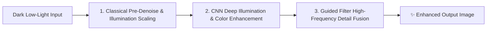

# 🌌 Low-Light Image Preprocessing Pipeline: Classical Vision, Deep Learning CNN & Hybrid Benchmark

An end-to-end Computer Vision & Deep Learning system for restoring severely degraded low-light images. This project implements and benchmarks **Classical Algorithms** (MSRCR Retinex, Lab-Space CLAHE, Adaptive Gamma, Bilateral/Guided Filtering), **Deep Learning Architectures** (Lightweight ResCNN, Multi-Scale U-Net, Zero-DCE), and a **Novel Hybrid Preprocessing Pipeline**.

---

## 📌 Architecture & Pipeline



---

## 🛠️ Features & Methods

### 1. Classical Vision Suite (`src/core/classical.py`)
- **Adaptive Gamma Correction (AGC)**: Dynamically calculates exponent $\gamma = -\log_2(\mu) \cdot \alpha$ from scene luminance.
- **Lab & HSV Space CLAHE**: Contrast-limited adaptive histogram equalization applied **strictly to the Luminance ($L$) or Value ($V$) channel** to prevent RGB color distortion.
- **Multi-Scale Retinex with Color Restoration (MSRCR)**: Decomposes scene into Reflectance and Illumination over 3 Gaussian scales ($\sigma = 15, 80, 250$) with color restoration gain.
- **Edge-Preserving Denoising**: Bilateral filter and Guided filter to smooth sensor noise while maintaining sharp structural edges.
- **Auto White Balance**: Gray-World color constancy algorithm.

### 2. Deep Learning Models (`src/core/models.py`)
- **`LowLightResCNN`**: Full-resolution residual network with global skip connections (no spatial downsampling, preserves high frequencies).
- **`UNetEnhancer`**: 3-level Encoder-Decoder with skip connections for wide contextual illumination understanding.
- **`ZeroDCENet`**: Zero-reference Deep Curve Estimation network.
- **Composite Loss Function (`src/core/losses.py`)**:
  $$\mathcal{L}_{total} = 1.0 \cdot \mathcal{L}_{\text{Charbonnier}} + 0.5 \cdot (1 - \text{SSIM}) + 0.2 \cdot \mathcal{L}_{\text{EdgeGradient}}$$

### 3. Synergistic Hybrid Pipeline (`src/core/hybrid.py`)
- **Stage 1 (Pre)**: Classical Bilateral Filtering attenuates sensor noise and conditions dynamic range.
- **Stage 2 (Core)**: Deep CNN expands dynamic range and restores chrominance.
- **Stage 3 (Post)**: Guided filter uses pre-filtered input as guidance to inject sharp edge details.

---

## 🚀 Quick Start & Usage

### 1. Installation
```bash
cd scratch/low_light_enhancement
pip install -r requirements.txt
```

### 2. Run Classical Enhancement on Any Image
```bash
python src/demo_classical.py --input data/forest.png
```

### 3. Launch Interactive Web App
```bash
streamlit run src/app.py
```

### 4. Run Automated Benchmark & Ablation Study
```bash
python src/evaluate.py
```

### 5. Train CNN on Dataset
```bash
python src/train.py --model res_cnn --epochs 50 --batch_size 4
```

---

## 📊 Image Quality Assessment (IQA) Metrics
- **Full-Reference**: PSNR (Peak Signal-to-Noise Ratio), SSIM (Structural Similarity), MSE, MAE, LPIPS.
- **No-Reference**: Shannon Information Entropy, RMS Contrast, Luminance distribution.
- **Efficiency**: Latency (ms/frame), Throughput (FPS), Parameter count ($M$).
