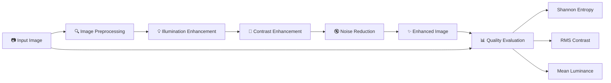
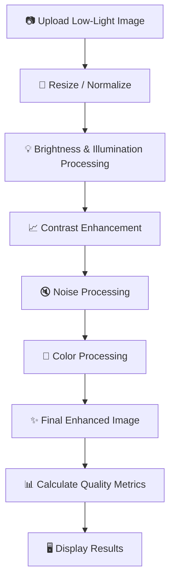
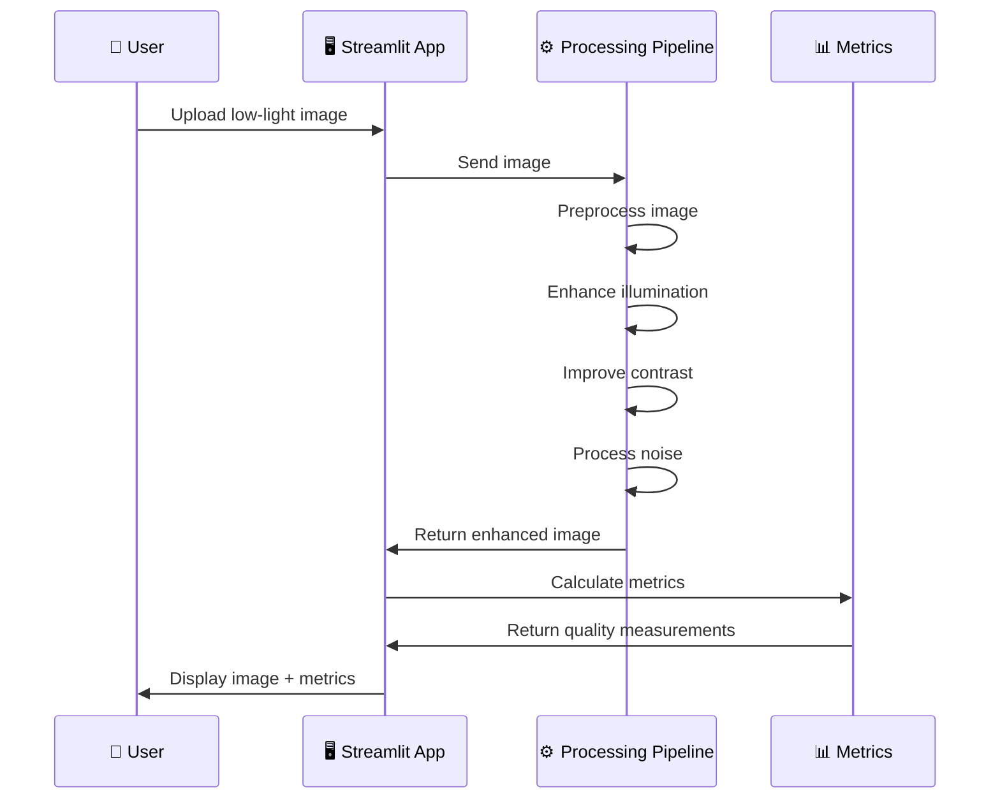

# 🌙 Low-Light Image Preprocessing & Enhancement

<p align="center">
  
  
  
  
</p>

<p align="center">
  <b>Enhancing visibility and image quality in low-light images using digital image processing techniques.</b>
</p>

---

## 📌 Overview

**Low-Light Image Preprocessing & Enhancement** is a computer vision project designed to improve the visual quality of images captured under poor lighting conditions.

Low-light images commonly suffer from:

- 🌑 Poor visibility
- 📉 Low contrast
- 🔇 Noise
- 💡 Uneven illumination
- 🎨 Color degradation
- 📊 Reduced information content

The project applies image-processing techniques to improve illumination, contrast, visibility, and overall image quality.

It also provides an interactive **Streamlit-based interface** where users can upload an image, process it, and compare the original and enhanced results.

---

# 🎯 Project Objectives

The main objectives are:

```text
             LOW-LIGHT IMAGE
                    │
                    ▼
          ┌───────────────────┐
          │ Image Preprocessing│
          └─────────┬─────────┘
                    │
                    ▼
          ┌───────────────────┐
          │ Enhancement       │
          │ Techniques        │
          └─────────┬─────────┘
                    │
                    ▼
          ┌───────────────────┐
          │ Quality Evaluation│
          └─────────┬─────────┘
                    │
                    ▼
            ENHANCED IMAGE
```

### Goals

- Improve image brightness
- Improve local and global contrast
- Reduce the effect of noise
- Preserve important image details
- Improve visual quality
- Provide quantitative quality measurements
- Provide an easy-to-use graphical interface

---

# 🏗️ System Architecture



---

# 🔄 Processing Pipeline



---

# 🧠 Image Processing

The project focuses on improving the major visual characteristics of a low-light image.

## 💡 Illumination Enhancement

Low-light images contain insufficient illumination.

The preprocessing pipeline enhances the intensity information while attempting to preserve important image details.

```text
Original
   │
   ▼
Low illumination
   │
   ▼
Illumination enhancement
   │
   ▼
Improved visibility
```

---

## 📈 Contrast Enhancement

Contrast enhancement improves the distinction between dark and bright regions.

This can make:

- Objects easier to identify
- Edges more visible
- Details clearer
- Dark regions more informative

---

## 🔇 Noise Processing

Low-light images can contain significant noise because cameras require higher sensor amplification in dark conditions.

The preprocessing pipeline can be used to reduce unwanted noise while attempting to preserve useful image information.

---

# 📊 Image Quality Metrics

The application provides quantitative measurements to evaluate the improvement.

## 1. 🧠 Shannon Entropy

**Shannon Entropy** measures the amount of information or intensity variation contained in an image.

Higher entropy can indicate a richer distribution of pixel intensities, although it should not be interpreted as a standalone measure of visual quality.

### Formula

```text
H(X) = - Σ p(x) log₂ p(x)
```

where:

- `p(x)` = probability of a particular intensity value
- `H(X)` = image entropy

---

## 2. 📊 RMS Contrast

RMS contrast measures the variation of pixel intensity around the mean intensity.

A higher value generally indicates greater intensity variation.

Conceptually:

```text
              Pixel Intensity
                    │
          ┌─────────┼─────────┐
          │         │         │
        Dark      Mean      Bright
          │         │         │
          └─────────┼─────────┘
                    │
             RMS Contrast
```

---

## 3. 💡 Mean Luminance

Mean luminance represents the average brightness of an image.

For an 8-bit image:

```text
0 ───────────────────────────── 255
Dark                          Bright
```

The application reports mean luminance on the **0–255 scale**.

---

# 📋 Example Evaluation

| Metric | Original | Enhanced | Change |
|---|---:|---:|---:|
| 🧠 Shannon Entropy | 4.79 | 7.20 | +2.41 |
| 📊 RMS Contrast | 0.154 | 0.208 | +0.054 |
| 💡 Mean Luminance | 57.1 | 125.1 | +68.0 |

> The exact values depend on the input image and preprocessing method.

---

# 🖥️ Streamlit Interface

The project provides a web-based interface using **Streamlit**.

```text
┌──────────────────────────────────────────────┐
│        🌙 LOW-LIGHT IMAGE ENHANCER           │
├──────────────────────────────────────────────┤
│                                              │
│  📤 Upload Image                             │
│                                              │
│  ┌────────────────┐    ┌────────────────┐    │
│  │                │    │                │    │
│  │ Original Image │ →  │ Enhanced Image│    │
│  │                │    │                │    │
│  └────────────────┘    └────────────────┘    │
│                                              │
├──────────────────────────────────────────────┤
│              📊 QUALITY METRICS              │
│                                              │
│  Shannon Entropy       7.20       +2.41      │
│  RMS Contrast          0.208      +0.054     │
│  Mean Luminance        125.1      +68.0      │
│                                              │
│             Reference: No-Reference          │
└──────────────────────────────────────────────┘
```

---

# 🚀 Running the Project

## 1. Clone the Repository

```bash
git clone https://github.com/rsshuvamsahu/-Low-light-image-preprocessing.git
```

## 2. Enter the Project

```bash
cd -Low-light-image-preprocessing
```

## 3. Create Virtual Environment

```bash
python -m venv .venv
```

### Windows

```powershell
.venv\Scripts\activate
```

---

## 4. Install Dependencies

If the repository contains a `requirements.txt`:

```bash
pip install -r requirements.txt
```

If dependencies are not already listed, install the required Python packages used by the project.

---

## 5. Start the Streamlit Application

From the project root:

```bash
python -m streamlit run src\app.py
```

The application will start locally and Streamlit will provide the local web address in the terminal.

---

# 📂 Project Structure

```text
-Low-light-image-preprocessing/
│
├── 📁 src/
│   ├── app.py
│   └── image-processing modules
│
├── 📁 data/
│   └── Input / test images
│
├── 📁 output/
│   └── Enhanced images
│
├── 📄 requirements.txt
├── 📄 README.md
└── 📄 Other project files
```

> The exact folder contents may vary as the project develops.

---

# 🔬 Processing Workflow



---

# 🧪 Evaluation

The enhancement result can be evaluated using both visual inspection and numerical measurements.

### Visual Evaluation

Compare:

```text
┌──────────────────┐       ┌──────────────────┐
│   🌑 Original    │  →    │   ✨ Enhanced    │
│   Low-Light      │       │     Image        │
└──────────────────┘       └──────────────────┘
```

### Quantitative Evaluation

The application reports:

- 🧠 Shannon Entropy
- 📊 RMS Contrast
- 💡 Mean Luminance

These metrics help quantify changes in image information, contrast, and brightness.

---

# 🛠️ Technologies Used

| Technology | Purpose |
|---|---|
| 🐍 Python | Core programming |
| 👁️ OpenCV | Image processing |
| 📊 NumPy | Numerical operations |
| 🖥️ Streamlit | Interactive web interface |
| 📈 Matplotlib | Visualization |
| 🐙 Git & GitHub | Version control |

---

# 🌟 Key Features

```text
✨ Low-Light Enhancement
│
├── 💡 Brightness Improvement
├── 📈 Contrast Enhancement
├── 🔇 Noise Processing
├── 🎨 Image Processing
├── 📊 Quality Metrics
│   ├── Shannon Entropy
│   ├── RMS Contrast
│   └── Mean Luminance
│
└── 🖥️ Streamlit Interface
```

---

# 📈 Advantages

- ✅ Simple and interactive interface
- ✅ Works with uploaded images
- ✅ Visual before/after comparison
- ✅ Quantitative image-quality analysis
- ✅ Useful for low-light image preprocessing
- ✅ Easy to run locally
- ✅ Modular structure for future improvements

---

# 🔮 Future Improvements

Possible future enhancements include:

- 🤖 Deep-learning-based enhancement
- 🌙 Retinex-based illumination estimation
- 📈 Additional quality metrics such as PSNR and SSIM when a reference image is available
- 🧠 No-reference quality metrics
- 🎥 Low-light video enhancement
- ⚡ GPU acceleration
- 📊 Detailed metric visualization
- 🖼️ Batch image processing
- ☁️ Deployment of the Streamlit application

---

# 🎓 Learning Outcomes

This project provides practical experience with:

- Digital Image Processing
- Computer Vision
- Image Enhancement
- Low-Light Image Analysis
- OpenCV
- Python
- Streamlit
- Image Quality Assessment
- Git & GitHub
- Building an interactive ML/CV application

---

# 👨‍💻 Git Workflow

For collaborative development:

```bash
# Get latest changes
git pull origin main

# Create a feature branch
git checkout -b feature-name

# Check changes
git status

# Add files
git add .

# Commit
git commit -m "Add image enhancement feature"

# Push branch
git push -u origin feature-name
```

After pushing, create a **Pull Request** to merge the feature branch into `main`.

---

# 🏁 Conclusion

**Low-Light Image Preprocessing & Enhancement** focuses on improving the visibility and quality of poorly illuminated images through digital image processing.

The project combines image enhancement techniques with quantitative evaluation and a Streamlit interface, allowing users to easily observe and measure the effect of preprocessing.

```text
       🌑 LOW-LIGHT IMAGE
               │
               ▼
       ⚙️ PREPROCESSING
               │
               ▼
       ✨ ENHANCEMENT
               │
               ▼
       📊 EVALUATION
               │
               ▼
       🖼️ BETTER VISIBILITY
```

---

<p align="center">
  <b>🌙 Low-Light Image Preprocessing</b>
  <br>
  <i>Computer Vision • Image Processing • Python • Streamlit</i>
</p>
